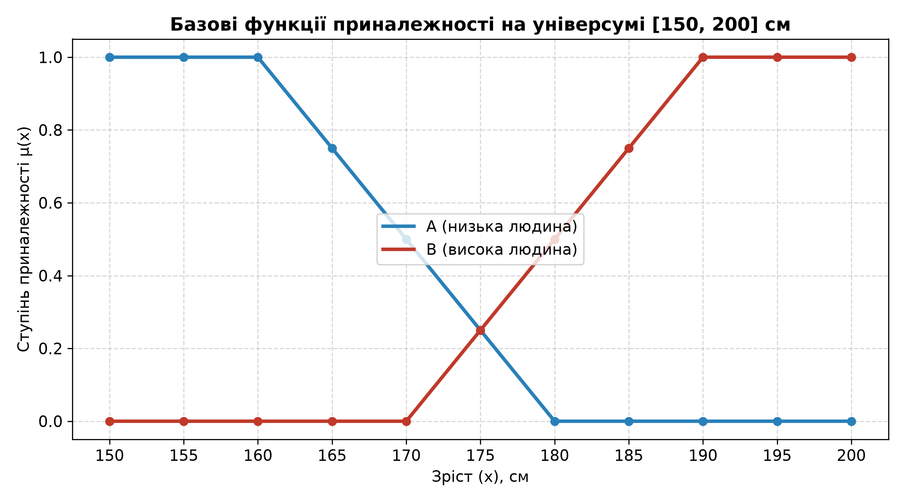
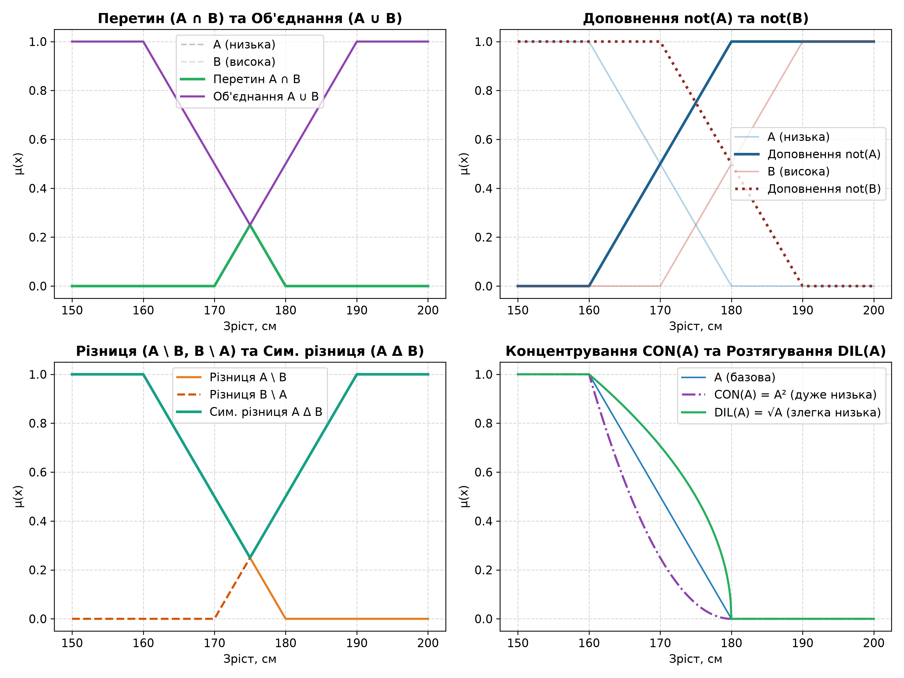
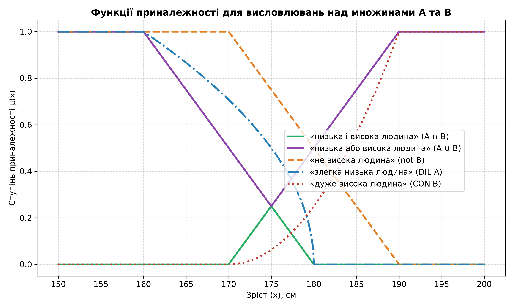

# Лабораторна робота №3: Операції над нечіткими множинами

Реалізація теоретико-множинних та логічних операцій над нечіткими множинами за Л. Заде, моделювання лінгвістичних висловлювань і перевірка фундаментальних алгебраїчних властивостей на універсумі зросту $[150, 200]$ см.

## Позначення та значки

- $\mu$ (мю) — ступінь приналежності елемента до нечіткої множини ($\mu \in [0, 1]$).
- $\neg$ (**not**) — операція доповнення множини (логічне заперечення «НЕ»).
- $\cap$ (**and**) — операція перетину множин (логічне множення «І», $\min$).
- $\cup$ (**or**) — операція об'єднання множин (логічне додавання «АБО», $\max$).
- $\setminus$ — різниця нечітких множин ($A$ без $B$).
- $\Delta$ (**xor**) — симетрична різниця (виключне «АБО»).
- $CON$ (**concentration**) — концентрування, піднесення до квадрату (модифікатор «дуже»).
- $DIL$ (**dilation**) — розтягування, взяття кореня (модифікатор «злегка»).

## Завдання
1. **Базові нечіткі множини** — задати функції приналежності множин $A = \{\text{низька людина}\}$ та $B = \{\text{висока людина}\}$ на універсумі $[150, 200]$ см, побудувати їх графіки.
2. **Операції над нечіткими множинами** — запрограмувати операції доповнення ($\neg$, not), перетину ($\cap$, and), об’єднання ($\cup$, or), різниці ($\setminus$), симетричної різниці ($\Delta$, xor), концентрування ($CON$) та розтягування ($DIL$).
3. **Моделювання висловлювань** — побудувати графіки функцій приналежності для висловлювань:
   - «низька і висока людина» ($A \cap B$, and)
   - «низька або висока людина» ($A \cup B$, or)
   - «не висока людина» ($\neg B$, not)
   - «злегка низька людина» ($DIL(A)$)
   - «дуже висока людина» ($CON(B)$)
4. **Перевірка властивостей** — чисельно перевірити комутативність, асоціативність, дистрибутивність, інволюцію та закони де Моргана, а також дослідити виконання законів виключеного третього та суперечності.

## Математичний апарат

- **Доповнення ($\neg$, not)**: $\mu_{\neg A}(x) = 1 - \mu_A(x)$
- **Перетин ($\cap$, and)**: $\mu_{A \cap B}(x) = \min(\mu_A(x), \mu_B(x))$
- **Об'єднання ($\cup$, or)**: $\mu_{A \cup B}(x) = \max(\mu_A(x), \mu_B(x))$
- **Різниця ($\setminus$)**: $\mu_{A \setminus B}(x) = \min(\mu_A(x), 1 - \mu_B(x))$
- **Симетрична різниця ($\Delta$, xor)**: $\mu_{A \Delta B}(x) = \max(\mu_{A \setminus B}(x), \mu_{B \setminus A}(x))$
- **Концентрування ($CON$, «дуже»)**: $\mu_{CON(A)}(x) = (\mu_A(x))^2$
- **Розтягування ($DIL$, «злегка»)**: $\mu_{DIL(A)}(x) = \sqrt{\mu_A(x)}$

## Структура проекту

```
.
├── main.py                     # Основний скрипт виконання лабораторної роботи
├── requirements.txt            # Залежності проекту (numpy, matplotlib)
├── README.md                   # Опис проекту та результатів
├── plots/                      # Згенеровані графіки
│   ├── task1_base_sets.png     # Графік базових множин A та B
│   ├── task2_operations.png    # Зведений графік теоретико-множинних операцій
│   └── task3_linguistic.png    # Графік модельованих лінгвістичних висловлювань
├── Звіт_Лабораторна_3.docx    # Звіт про виконання роботи
└── L3.pdf                      # Методичні вказівки
```

## Встановлення та запуск

```bash
cd Lab3
python3 -m venv .venv
source .venv/bin/activate
pip install -r requirements.txt
python3 main.py
deactivate
```

## Результати розрахунків

### 1. Базові функції приналежності на універсумі $[150, 200]$ см

| Зріст, см | 150 | 155 | 160 | 165 | 170 | 175 | 180 | 185 | 190 | 195 | 200 |
|---|---|---|---|---|---|---|---|---|---|---|---|
| **$\mu_A$ (низька)** | 1.00 | 1.00 | 1.00 | 0.75 | 0.50 | 0.25 | 0.00 | 0.00 | 0.00 | 0.00 | 0.00 |
| **$\mu_B$ (висока)** | 0.00 | 0.00 | 0.00 | 0.00 | 0.00 | 0.25 | 0.50 | 0.75 | 1.00 | 1.00 | 1.00 |

### 2. Лінгвістичні висловлювання

| Зріст, см | «низька і висока» ($A \cap B$, and) | «низька або висока» ($A \cup B$, or) | «не висока» ($\neg B$, not) | «злегка низька» ($DIL$) | «дуже висока» ($CON$) |
|---|---|---|---|---|---|
| 150 | 0.00 | 1.00 | 1.00 | 1.00 | 0.00 |
| 160 | 0.00 | 1.00 | 1.00 | 1.00 | 0.00 |
| 170 | 0.00 | 0.50 | 1.00 | 0.71 | 0.00 |
| 175 | 0.25 | 0.25 | 0.75 | 0.50 | 0.06 |
| 180 | 0.00 | 0.50 | 0.50 | 0.00 | 0.25 |
| 190 | 0.00 | 1.00 | 0.00 | 0.00 | 1.00 |
| 200 | 0.00 | 1.00 | 0.00 | 0.00 | 1.00 |

### 3. Числова перевірка властивостей

| Властивість | Формула | Макс. похибка | Результат |
|---|---|---|---|
| Комутативність $\cap$ (and / і) | $A \cap B = B \cap A$ | $0.00$ | Виконується (True) |
| Комутативність $\cup$ (or / або) | $A \cup B = B \cup A$ | $0.00$ | Виконується (True) |
| Асоціативність $\cap$ (and / і) | $(A \cap B) \cap C = A \cap (B \cap C)$ | $0.00$ | Виконується (True) |
| Асоціативність $\cup$ (or / або) | $(A \cup B) \cup C = A \cup (B \cup C)$ | $0.00$ | Виконується (True) |
| Дистрибутивність $\cap$ до $\cup$ (and до or) | $A \cap (B \cup C) = (A \cap B) \cup (A \cap C)$ | $0.00$ | Виконується (True) |
| Дистрибутивність $\cup$ до $\cap$ (or до and) | $A \cup (B \cap C) = (A \cup B) \cap (A \cup C)$ | $0.00$ | Виконується (True) |
| Інволюція (подвійне $\neg$, not) | $\neg(\neg A) = A$ | $5.55 \times 10^{-17}$ | Виконується (True) |
| Закон де Моргана (1) (not для or) | $\neg(A \cup B) = \neg A \cap \neg B$ | $0.00$ | Виконується (True) |
| Закон де Моргана (2) (not для and) | $\neg(A \cap B) = \neg A \cup \neg B$ | $0.00$ | Виконується (True) |

> **Примітка щодо законів класичної логіки:**
> - Закон виключеного третього ($A \cup \neg A$, or): $\min(A \cup \neg A) = 0.50 \ne 1.0$ (НЕ зберігається для нечітких множин).
> - Закон суперечності ($A \cap \neg A$, and): $\max(A \cap \neg A) = 0.50 \ne 0.0$ (НЕ зберігається для нечітких множин).

## Графіки

| Базові множини $A$ та $B$ | Операції над множинами | Модельовані висловлювання |
| :---: | :---: | :---: |
|  |  |  |
