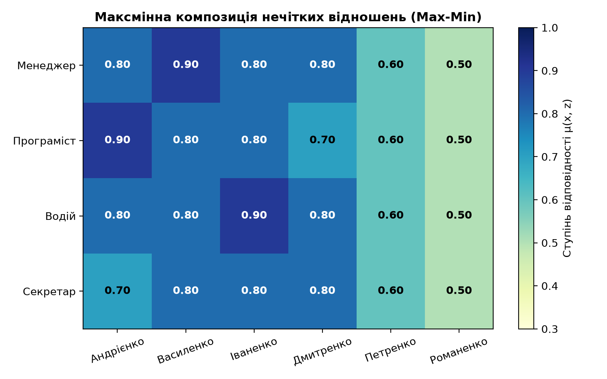
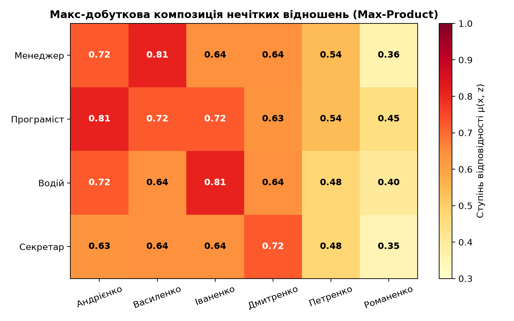
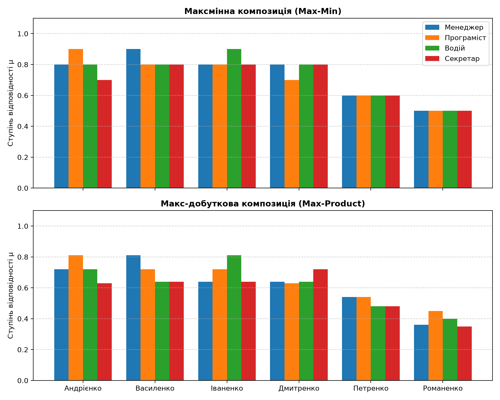

# Лабораторна робота №4: Композиція нечітких бінарних відношень

Реалізація операцій композиції бінарних нечітких відношень (максмінної та альтернативної макс-добуткової) для розв'язання задачі консалтингу у сфері професійної орієнтації на базі бібліотеки **NumPy**.

## Завдання
1. Застосувати операцію композиції бінарних нечітких відношень у задачі професійного консалтингу щодо вибору спеціальності на основі психо-фізіологічного профілювання:
   - $X$ — множина спеціальностей ($x_1$ — менеджер, $x_2$ — програміст, $x_3$ — водій, $x_4$ — секретар);
   - $Y$ — множина характеристик ($y_1$ — гнучкість мислення, $y_2$ — швидкість прийняття рішень, $y_3$ — концентрація уваги, $y_4$ — зорова пам'ять, $y_5$ — витривалість, $y_6$ — швидкість реакції, $y_7$ — відповідальність);
   - $Z$ — множина претендентів ($z_1$ — Андрієнко, $z_2$ — Василенко, $z_3$ — Іваненко, $z_4$ — Дмитренко, $z_5$ — Петренко, $z_6$ — Романенко).
2. Задати експертні нечіткі відношення:
   - $S \subseteq X \times Y$ — матриця профілювання спеціальностей $M_S$ ($4 \times 7$);
   - $Q \subseteq Y \times Z$ — матриця профілювання претендентів $M_Q$ ($7 \times 6$).
3. Запрограмувати алгоритм максмінної композиції $S \circ Q$ для визначення переваг і недоліків претендентів.
4. Реалізувати альтернативну макс-добуткову композицію $S \cdot Q$, порівняти результати обох підходів.

## Математичний апарат та формули

1. **Максмінна композиція (Max-Min, композиція Заде):**
   $$\mu_{S \circ Q}(x_i, z_k) = \max_{j=1..7} \min \left( \mu_S(x_i, y_j), \mu_Q(y_j, z_k) \right) = \bigvee_{j=1}^7 \left( \mu_S(x_i, y_j) \wedge \mu_Q(y_j, z_k) \right)$$

2. **Макс-добуткова композиція (Max-Product):**
   $$\mu_{S \cdot Q}(x_i, z_k) = \max_{j=1..7} \left( \mu_S(x_i, y_j) \cdot \mu_Q(y_j, z_k) \right) = \bigvee_{j=1}^7 \left( \mu_S(x_i, y_j) \cdot \mu_Q(y_j, z_k) \right)$$

## Структура проекту
```
.
├── main.py                          # Скрипт розрахунків та генерації графіків
├── requirements.txt                 # Залежності проекту (numpy, matplotlib)
├── .gitignore                       # Ігнорування середовища .venv та кешу
├── README.md                        # Короткий опис та інструкція запуску
├── plots/                           # Згенеровані графіки результатів
│   ├── maxmin_composition.png       # Теплова карта максмінної композиції
│   ├── maxprod_composition.png      # Теплова карта макс-добуткової композиції
│   └── composition_comparison.png   # Порівняльна діаграма двох методів
├── Звіт_Лабораторна_4.docx          # Звіт за академічними вимогами
└── L4.pdf                           # Методичні вказівки до роботи
```

## Встановлення та запуск у віртуальному середовищі

1. Перейти в робочу директорію:
   ```bash
   cd Lab4
   ```

2. Створити та активувати віртуальне середовище:
   - **Linux / macOS:**
     ```bash
     python3 -m venv .venv
     source .venv/bin/activate
     ```
   - **Windows (PowerShell):**
     ```powershell
     python -m venv .venv
     .venv\Scripts\Activate.ps1
     ```
   - **Windows (CMD):**
     ```cmd
     python -m venv .venv
     .venv\Scripts\activate.bat
     ```

3. Встановити залежності:
   ```bash
   pip install -r requirements.txt
   ```

4. Запустити розрахунки:
   ```bash
   python main.py
   ```

5. Деактивація середовища після завершення:
   ```bash
   deactivate
   ```

## Результати

### Підсумкові матриці рекомендацій

**Максмінна композиція ($R_1 = S \circ Q$):**
| Спеціальність | Андрієнко | Василенко | Іваненко | Дмитренко | Петренко | Романенко |
|:--------------|:---------:|:---------:|:--------:|:---------:|:--------:|:---------:|
| Менеджер      | 0.80      | **0.90**  | 0.80     | 0.80      | 0.60     | 0.50      |
| Програміст    | **0.90**  | 0.80      | 0.80     | 0.70      | 0.60     | 0.50      |
| Водій         | 0.80      | 0.80      | **0.90** | 0.80      | 0.60     | 0.50      |
| Секретар      | 0.70      | **0.80**  | **0.80** | **0.80**  | 0.60     | 0.50      |

**Макс-добуткова композиція ($R_2 = S \cdot Q$):**
| Спеціальність | Андрієнко | Василенко | Іваненко | Дмитренко | Петренко | Романенко |
|:--------------|:---------:|:---------:|:--------:|:---------:|:--------:|:---------:|
| Менеджер      | 0.72      | **0.81**  | 0.64     | 0.64      | 0.54     | 0.36      |
| Програміст    | **0.81**  | 0.72      | 0.72     | 0.63      | 0.54     | 0.45      |
| Водій         | 0.72      | 0.64      | **0.81** | 0.64      | 0.48     | 0.40      |
| Секретар      | 0.63      | 0.64      | 0.64     | **0.72**  | 0.48     | 0.35      |

### Висновки з розподілу професій
- **Менеджер ($x_1$)**: найкращий кандидат — **Василенко** ($\mu = 0.81$ у Max-Prod) завдяки високому розвитку швидкості рішень та гнучкості мислення.
- **Програміст ($x_2$)**: найкращий кандидат — **Андрієнко** ($\mu = 0.81$ у Max-Prod) завдяки найвищій концентрації уваги ($0.9$) та зоровій пам'яті.
- **Водій ($x_3$)**: найкращий кандидат — **Іваненко** ($\mu = 0.81$ у Max-Prod) завдяки відмінній витривалості ($0.9$) та швидкості рухових реакцій ($0.9$).
- **Секретар ($x_4$)**: у той час як Max-Min дає нічию ($0.80$) між трьома претендентами, Max-Product чітко диференціює та обирає **Дмитренка** ($\mu = 0.72$), оскільки він має найвищий рівень зорової пам'яті ($0.9$), критичної для діловодства.

| Теплова карта (Max-Min) | Теплова карта (Max-Product) | Порівняння методів |
| :---: | :---: | :---: |
|  |  |  |
