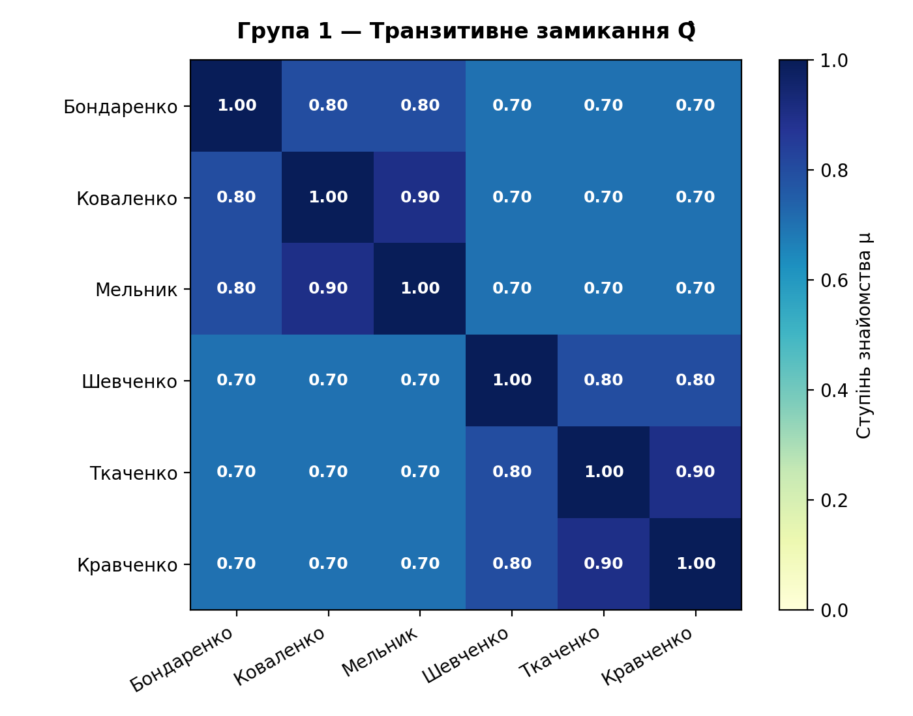
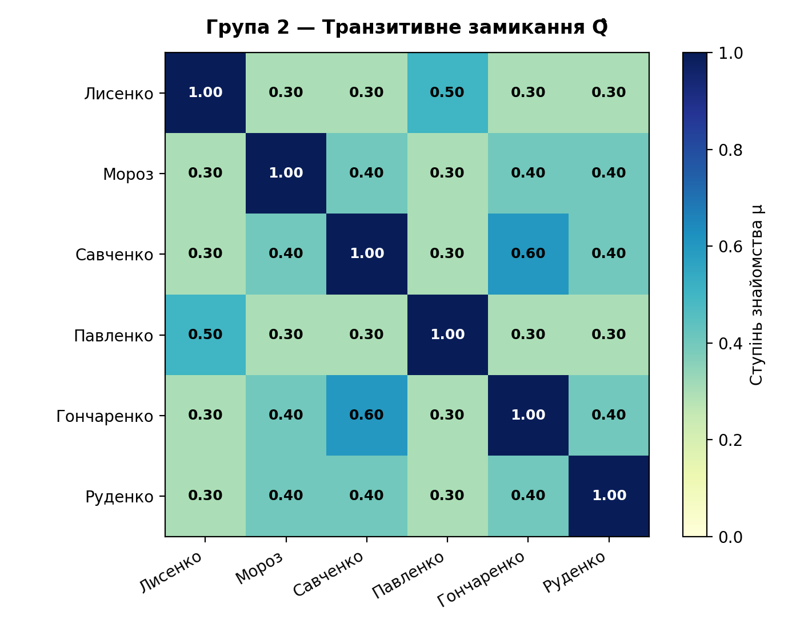
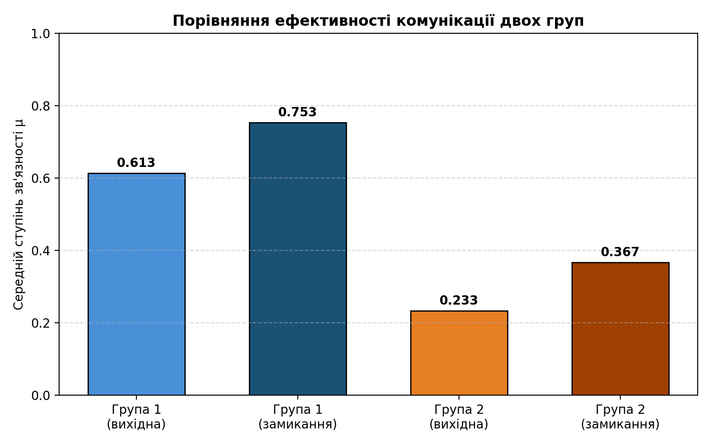

# Лабораторна робота №5: Транзитивне замикання нечітких бінарних відношень

Аналіз ефективності комунікації в колективах на основі транзитивного замикання нечітких бінарних відношень з використанням бібліотеки **NumPy**.

## Завдання
1. Задати бінарне нечітке відношення Q (рефлексивне, симетричне), що описує умову «особа xi добре знайома з xj» у двох групах студентів.
2. Запрограмувати алгоритм транзитивного замикання за допомогою max-min композиції для визначення ефективності поширення інформації через ланцюги посередників.
3. Порівняти результати для групи з високою зв'язністю (одногрупники) та низькою зв'язністю (різні факультети).

## Математичний апарат

**Max-min композиція:**
$$\mu_{Q^2}(x_i, x_j) = \max_{k} \min(\mu_Q(x_i, x_k), \mu_Q(x_k, x_j))$$

**Транзитивне замикання:**
$$\hat{Q} = Q \cup Q^2 \cup Q^3 \cup \ldots$$

Процес зупиняється коли $Q^n = Q^{n+1}$ (стабілізація).

## Структура проекту
```
.
├── main.py                        # Скрипт розрахунків та побудови графіків
├── requirements.txt               # Залежності (numpy, matplotlib)
├── .gitignore                     # Ігнорування .venv та __pycache__
├── README.md                      # Опис та інструкція запуску
├── plots/                         # Згенеровані графіки
│   ├── group1_original.png        # Теплова карта Q1 (вихідна)
│   ├── group1_closure.png         # Теплова карта Q̂1 (замикання)
│   ├── group2_original.png        # Теплова карта Q2 (вихідна)
│   ├── group2_closure.png         # Теплова карта Q̂2 (замикання)
│   └── comparison.png             # Порівняння зв'язності двох груп
├── Звіт_Лабораторна_5.docx        # Звіт за академічними вимогами
└── L5.pdf                         # Методичні вказівки
```

## Встановлення та запуск

1. Перейти в директорію:
   ```bash
   cd Lab5
   ```

2. Створити віртуальне середовище:
   - **Linux / macOS:**
     ```bash
     python3 -m venv .venv
     source .venv/bin/activate
     ```
   - **Windows (PowerShell):**
     ```powershell
     python -m venv .venv
     .venv\Scripts\Activate.ps1
     ```

3. Встановити залежності:
   ```bash
   pip install -r requirements.txt
   ```

4. Запустити:
   ```bash
   python main.py
   ```

5. Деактивація:
   ```bash
   deactivate
   ```

## Результати

### Група 1 (одногрупники) — транзитивне замикання Q̂1
| Прізвище | Бондаренко | Коваленко | Мельник | Шевченко | Ткаченко | Кравченко |
|:---------|:----------:|:---------:|:-------:|:--------:|:--------:|:---------:|
| Бондаренко | 1.00 | 0.80 | **0.80** | 0.70 | **0.70** | **0.70** |
| Коваленко  | 0.80 | 1.00 | 0.90 | **0.70** | **0.70** | **0.70** |
| Мельник    | **0.80** | 0.90 | 1.00 | **0.70** | 0.70 | **0.70** |
| Шевченко   | 0.70 | **0.70** | **0.70** | 1.00 | 0.80 | **0.80** |
| Ткаченко   | **0.70** | **0.70** | 0.70 | 0.80 | 1.00 | 0.90 |
| Кравченко  | **0.70** | **0.70** | **0.70** | **0.80** | 0.90 | 1.00 |

Середня зв'язність: **0.613 → 0.753**

### Група 2 (різні факультети) — транзитивне замикання Q̂2
| Прізвище | Лисенко | Мороз | Савченко | Павленко | Гончаренко | Руденко |
|:---------|:-------:|:-----:|:--------:|:--------:|:----------:|:-------:|
| Лисенко    | 1.00 | 0.30 | **0.30** | 0.50 | **0.30** | **0.30** |
| Мороз      | 0.30 | 1.00 | 0.40 | **0.30** | **0.40** | **0.40** |
| Савченко   | **0.30** | 0.40 | 1.00 | **0.30** | 0.60 | **0.40** |
| Павленко   | 0.50 | **0.30** | **0.30** | 1.00 | **0.30** | 0.30 |
| Гончаренко | **0.30** | **0.40** | 0.60 | **0.30** | 1.00 | 0.40 |
| Руденко    | **0.30** | **0.40** | **0.40** | 0.30 | 0.40 | 1.00 |

Середня зв'язність: **0.233 → 0.367**

### Висновок
- **Група 1**: висока ефективність комунікації — навіть слабко знайомі студенти можуть ефективно передавати інформацію через посередників (μ ≥ 0.70).
- **Група 2**: низька ефективність — зв'язки через посередників слабкі (μ ≤ 0.40), що робить непряму комунікацію малоефективною.

| Група 1 (замикання) | Група 2 (замикання) | Порівняння |
| :---: | :---: | :---: |
|  |  |  |
