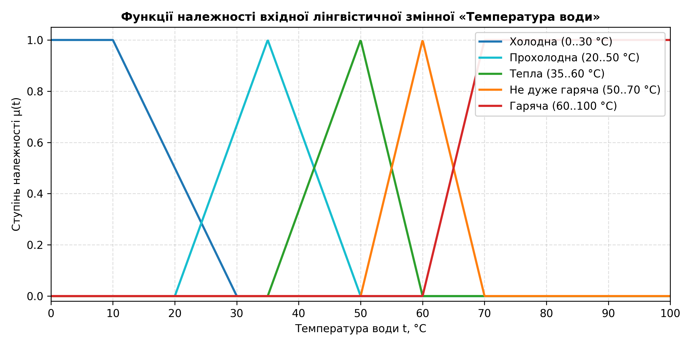
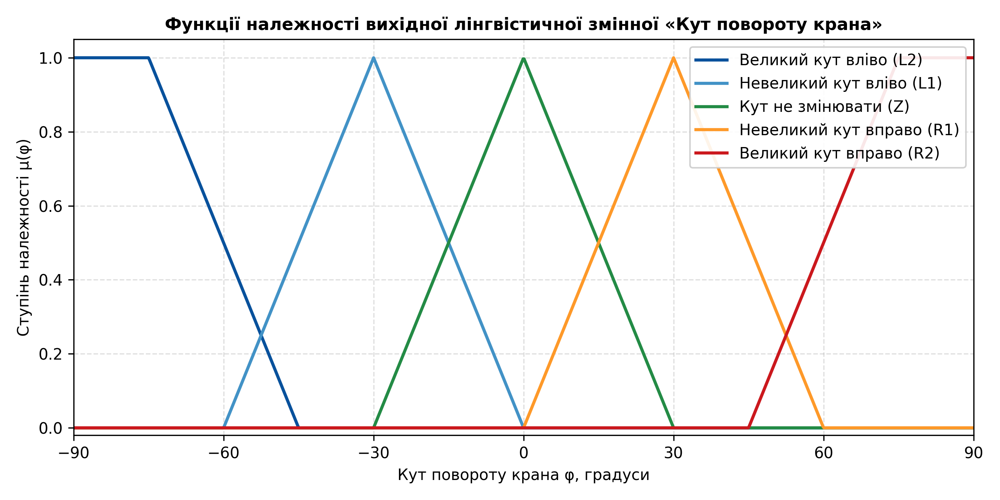
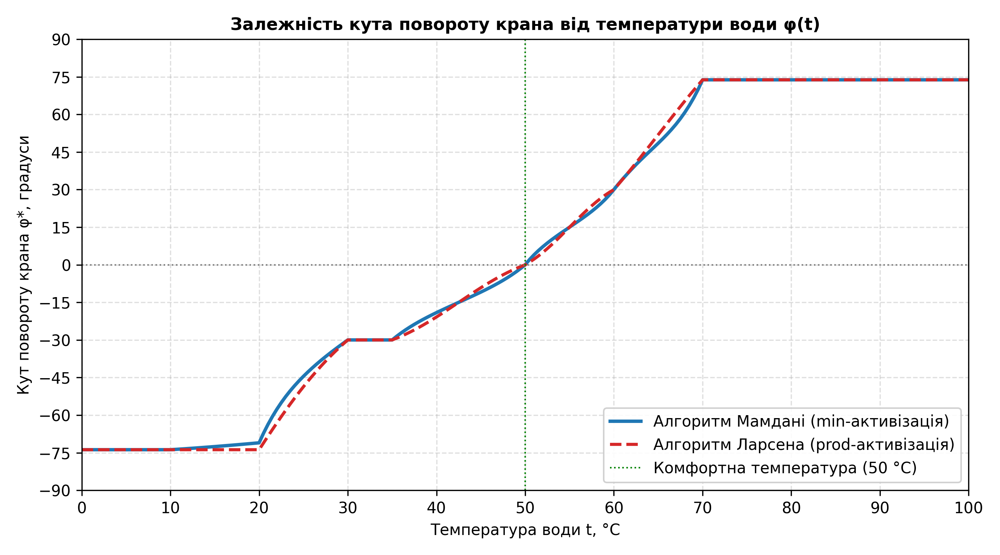
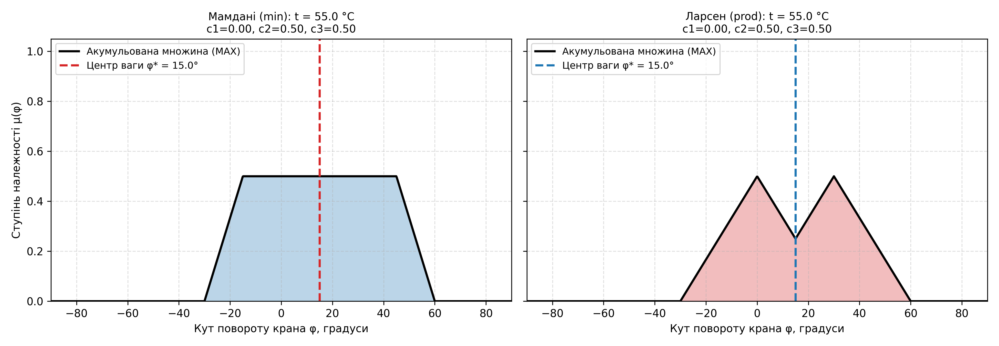

# Лабораторна робота №6: Проектування та аналіз нечітких систем типу Мамдані

Розробка та порівняльний аналіз контролера нечіткої логіки для автоматичного керування змішувачем душу на основі алгоритмів логічного висновку **Мамдані** ($\min$-активізація) та **Ларсена** ($\operatorname{prod}$-активізація) з дефазифікацією методом центру ваги на базі бібліотек **NumPy** та **Matplotlib**.

## Завдання роботи
1. Спроєктувати базу нечітких продукційних правил для автоматичного регулювання положення вентиля змішувача залежно від температури води.
2. Аналітично задати функції належності для 5 термів вхідної лінгвістичної змінної «температура води» ($t \in [0, 100]\,^\circ\text{C}$) та 5 термів вихідної лінгвістичної змінної «кут повороту крана» ($\varphi \in [-90^\circ, +90^\circ]$).
3. Програмно реалізувати алгоритми Мамдані та Ларсена для обчислення ступенів істинності умов ($c_i$), активізації консеквентів, процедури $\max$-акумуляції та дефазифікації методом центру ваги (Center of Gravity).
4. Побудувати графіки характеристик керування $\varphi(t)$, виконати порівняльний аналіз методів та оцінити їхню роботу в зоні комфортної температури.

---

## База нечітких продукційних правил

| Правило | Умова (Антецедент $c_i = \mu_i^{in}(t)$) | Висновок (Консеквент $\mu_i^{out}(\varphi)$) |
|:-------:|:-----------------------------------------|:---------------------------------------------|
| **$R_1$** | **ЯКЩО** вода гаряча | **ТО** повернути вентиль на великий кут вправо ($R_2$) |
| **$R_2$** | **ЯКЩО** вода не дуже гаряча | **ТО** повернути вентиль на невеликий кут вправо ($R_1$) |
| **$R_3$** | **ЯКЩО** вода тепла | **ТО** кут повороту вентиля не змінювати ($Z$) |
| **$R_4$** | **ЯКЩО** вода прохолодна | **ТО** повернути вентиль на невеликий кут вліво ($L_1$) |
| **$R_5$** | **ЯКЩО** вода холодна | **ТО** повернути вентиль на великий кут вліво ($L_2$) |

---

## Математичний апарат

1. **Фазифікація:** обчислення ступенів істинності умов $c_i = \mu_i^{in}(t), \quad i \in \{1, 2, 3, 4, 5\}$.
2. **Активізація консеквентів правил:**
   - **Алгоритм Мамдані ($\min$-зрізання, clipping):**
     $$\mu_i^{'out}(\varphi) = \min \left( c_i, \mu_i^{out}(\varphi) \right)$$
   - **Алгоритм Ларсена ($\operatorname{prod}$-масштабування, scaling):**
     $$\mu_i^{'out}(\varphi) = c_i \cdot \mu_i^{out}(\varphi)$$
3. **Акумуляція висновків ($\max$-об'єднання):**
   $$\mu^{'out}(\varphi) = \max_{i=1..5} \mu_i^{'out}(\varphi)$$
4. **Дефазифікація (метод центру ваги):**
   $$\varphi^* = \frac{\int_{-90}^{90} \varphi \cdot \mu^{'out}(\varphi) \, d\varphi}{\int_{-90}^{90} \mu^{'out}(\varphi) \, d\varphi} \approx \frac{\sum_k \varphi_k \cdot \mu^{'out}(\varphi_k)}{\sum_k \mu^{'out}(\varphi_k)}$$

---

## Структура проекту

```
Lab6/
├── main.py                               # Скрипт розрахунків та генерації графіків
├── requirements.txt                      # Залежності проекту (numpy, matplotlib)
├── .gitignore                            # Ігнорування віртуального середовища та кешу
├── README.md                             # Опис проекту та інструкція запуску
├── plots/                                # Згенеровані графічні результати
│   ├── input_membership_functions.png    # Графік функцій належності температури води
│   ├── output_membership_functions.png   # Графік функцій належності кута повороту
│   ├── control_characteristic_comparison.png # Порівняння характеристик Mamdani vs Larsen
│   └── fuzzy_inference_example.png       # Порівняння активізацій для t = 55 °C
├── Звіт_Лабораторна_6.docx               # Звіт відповідно до академічних вимог
└── L6.pdf                                # Методичні вказівки до лабораторної роботи
```

---

## Встановлення та запуск у віртуальному середовищі

1. Перейти в робочу директорію:
   ```bash
   cd Lab6
   ```

2. Створити та активувати віртуальне середовище:
   - **Linux / macOS:**
     ```bash
     python3 -m venv .venv
     source .venv/bin/activate
     ```
   - **Windows (PowerShell):**
     ```powershell
     python -m venv .venv
     .venv\Scripts\Activate.ps1
     ```
   - **Windows (CMD):**
     ```cmd
     python -m venv .venv
     .venv\Scripts\activate.bat
     ```

3. Встановити залежності:
   ```bash
   pip install -r requirements.txt
   ```

4. Запустити розрахунки та генерацію графіків:
   ```bash
   python main.py
   ```

5. Деактивація середовища після завершення:
   ```bash
   deactivate
   ```

---

## Результати моделювання

### Розрахункові значення у контрольних точках

| $t, ^\circ\text{C}$ | Активовані правила | Mamdani $\varphi^*, ^\circ$ | Larsen $\varphi^*, ^\circ$ | Пояснення реакції системи |
|:---:|:---|:---:|:---:|:---|
| **0.0** | $R_5 = 1.00$ | **-73.80** | **-73.80** | Критично холодна вода: максимальний поворот вліво |
| **15.0** | $R_5 = 0.75$ | **-72.55** | **-73.80** | Холодна вода: сильний поворот крана вліво |
| **25.0** | $R_4 = 0.33, R_5 = 0.25$ | **-44.51** | **-48.68** | Перехідна зона між холодною та прохолодною водою |
| **35.0** | $R_4 = 1.00$ | **-30.00** | **-30.00** | Прохолодна вода: фіксований кут вліво на $-30^\circ$ |
| **42.0** | $R_3 = 0.47, R_4 = 0.53$ | **-15.80** | **-16.19** | Плавне наближення до зони комфорту |
| **50.0** | $R_3 = 1.00$ | **0.00** | **0.00** | Комфортна тепла вода: кут вентиля не змінюється |
| **55.0** | $R_2 = 0.50, R_3 = 0.50$ | **+15.00** | **+15.00** | Симетричний перехід до теплої/гарячої води |
| **60.0** | $R_2 = 1.00$ | **+30.00** | **+30.00** | Не дуже гаряча вода: фіксований кут вправо на $+30^\circ$ |
| **65.0** | $R_1 = 0.50, R_2 = 0.50$ | **+48.50** | **+51.91** | Перехідна зона до гарячої води |
| **80.0** | $R_1 = 1.00$ | **+73.80** | **+73.80** | Критично гаряча вода: максимальний поворот вправо |
| **100.0** | $R_1 = 1.00$ | **+73.80** | **+73.80** | Максимальна температура: максимальний поворот вправо |

### Ключові висновки порівняльного аналізу
- **Алгоритм Мамдані ($\min$):** внаслідок відсікання вершин («зрізу») вихідних функцій належності площа фігур змінюється нелінійно, формуючи невеликі сходинки та плато в перехідних зонах.
- **Алгоритм Ларсена ($\operatorname{prod}$):** масштабує консеквенти пропорційно вазі правила зі збереженням їхньої геометричної форми (трикутники залишаються трикутниками), забезпечуючи гладку монотонну криву регулювання без різких перегинів.
- **Зона стабілізації ($t = 50^\circ\text{C}$):** обидва алгоритми забезпечують ідеальну інваріантність $\varphi^* = 0.00^\circ$, що гарантує відсутність помилкових автоколивань змішувача в комфортному режимі.

---

## Графічні матеріали

| Функції належності входу | Функції належності виходу |
|:---:|:---:|
|  |  |

| Порівняння Mamdani та Larsen | Приклад висновку ($t = 55^\circ\text{C}$) |
|:---:|:---:|
|  |  |
